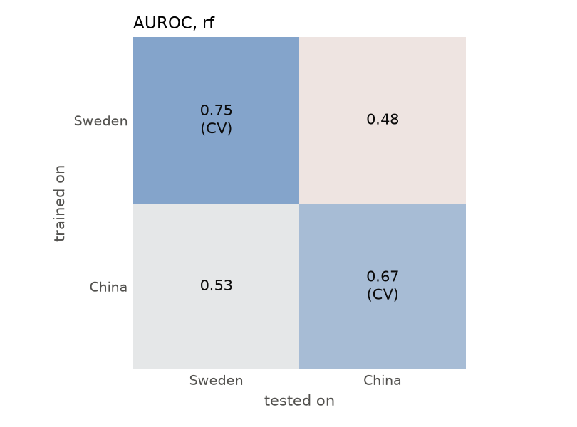
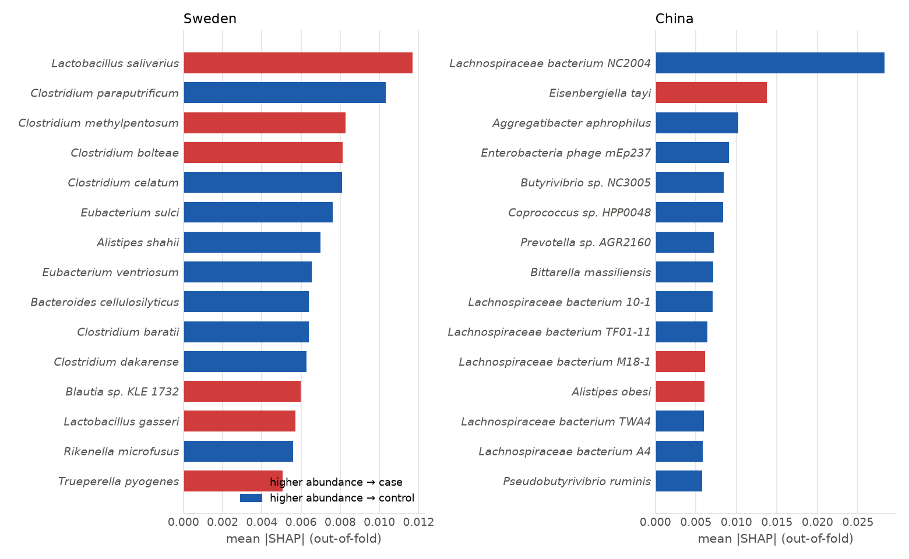
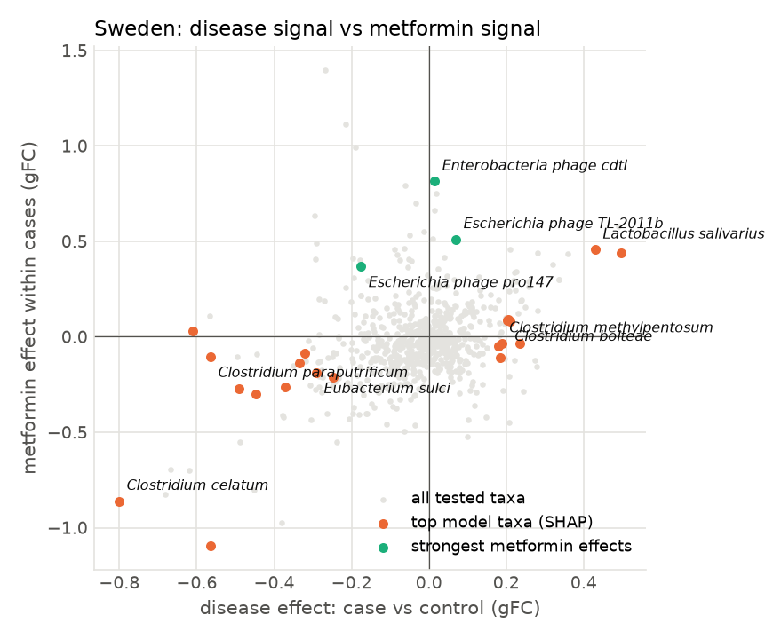
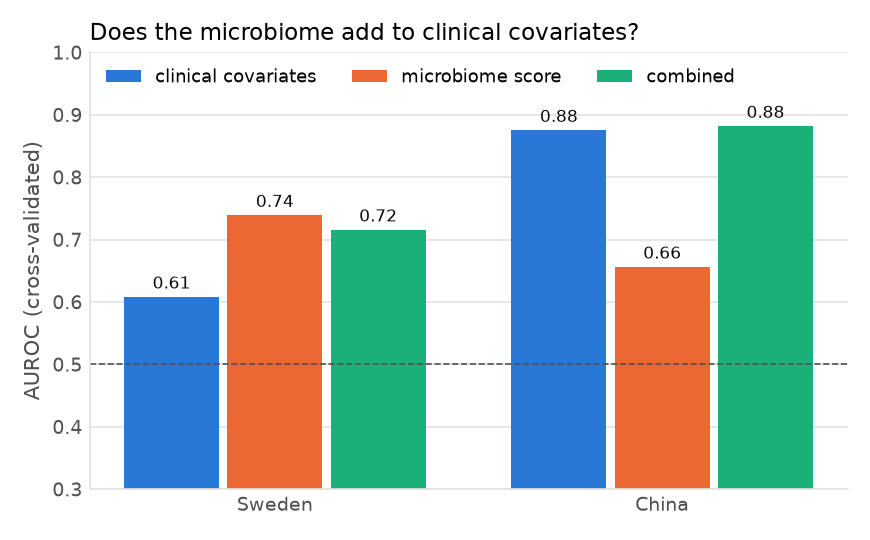
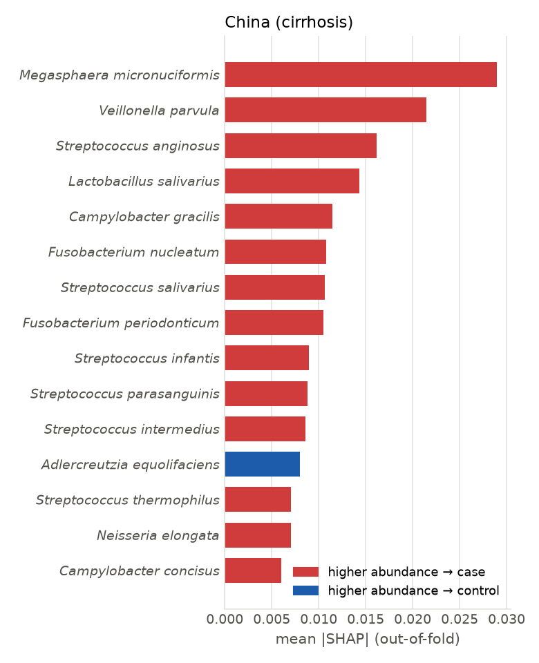
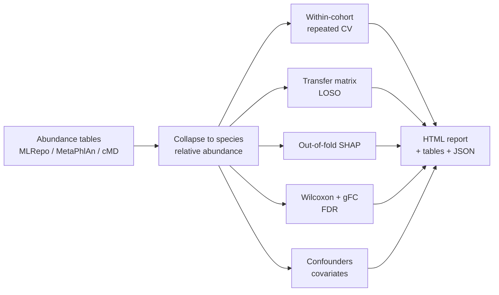

# microbiome-xai — explainable, cross-cohort gut microbiome biomarkers

[](https://github.com/synmutanX/microbiome-xai/actions/workflows/ci.yml)


Many gut-microbiome "disease signatures" look impressive in one study and fail in the next. `mbxai` is a small,
tested Python toolkit that asks the questions a company has to answer **before** building a product on a
microbiome biomarker:

1. **Is there a signal?** Leakage-free, repeated cross-validation within each cohort.
2. **Does it transfer?** Train in one country or study, test in another (transfer matrix, leave-one-study-out).
3. **What drives it?** Out-of-fold SHAP explanations per cohort, compared across cohorts and cross-checked with
   univariate statistics.
4. **Is it the disease or something else?** Confounder checks (e.g. drug treatment) and whether the microbiome adds
   anything beyond routine clinical covariates.

Every analysis runs from one YAML file and produces a self-contained HTML report.

```bash
pip install -e .
mbxai fetch-mlrepo --out data/mlrepo                     # public data, ~4 MB
mbxai run configs/t2d_sweden_china.yaml --out results/t2d_sweden_china
open results/t2d_sweden_china/report.html
```

## Case study 1: type 2 diabetes in Sweden and China

Two public shotgun metagenomic cohorts processed with the same pipeline by the
[Microbiome Learning Repo](https://github.com/knights-lab/MLRepo):
Sweden ([Karlsson et al. 2013](https://doi.org/10.1038/nature12198); 53 T2D vs 43 normal glucose tolerance) and
China ([Qin et al. 2012](https://doi.org/10.1038/nature11450); 65 T2D vs 59 controls).

**A within-cohort signal exists but does not transfer.**

| AUROC (95% CI) | Random forest | L1-logistic |
|---|---|---|
| Sweden, cross-validated | 0.75 (0.65–0.84) | 0.70 (0.60–0.81) |
| China, cross-validated | 0.67 (0.56–0.76) | 0.65 (0.55–0.74) |
| Trained in Sweden → tested in China | 0.48 (0.38–0.58) | 0.39 (0.29–0.49) |
| Trained in China → tested in Sweden | 0.53 (0.42–0.65) | 0.48 (0.37–0.60) |

<p float="left">
  
  
</p>

**The two models rely on different taxa.** Only 1 of the top-20 SHAP taxa is shared between countries
(Jaccard 0.03). Part of this is technical: Chinese samples have a median of 128 detected species versus 426 in
Swedish samples (different sequencing depth and read length), and only 38% of the taxa the Swedish model uses are
ever detected in the Chinese cohort. Restricting both cohorts to taxa detected in both
([`configs/t2d_sweden_china_shared_taxa.yaml`](configs/t2d_sweden_china_shared_taxa.yaml)) does **not** rescue
transfer (AUROC 0.49 and 0.51), and lowers the Swedish within-cohort AUROC to 0.63. So the failure is not only
missing features. Population, diet and study protocol cannot be separated with two cohorts.

**Part of the Swedish signal is metformin.** 20 of the 53 Swedish T2D patients take metformin. Among patients, the
taxa most associated with metformin are *E. coli*-related (Enterobacteria phages, *Shigella*, *E. coli*), consistent with
[Forslund et al. 2015](https://doi.org/10.1038/nature15766). Removing the metformin-treated patients lowers the
AUROC from 0.75 to 0.65 (0.52–0.77), and only 55% of the top-20 taxa stay in the top 20.

<p float="left">
  
  
</p>

**Clinical covariates matter.** In the Chinese cohort, BMI and age alone reach AUROC 0.88. The microbiome score
still adds information (likelihood-ratio test p = 0.018), but a T2D microbiome test would have to beat a tape
measure and a birth date. In Sweden the microbiome score is more informative than BMI and age (0.74 vs 0.61,
p = 0.0002).

## Case study 2: liver cirrhosis — what a strong signal looks like

Cirrhosis vs healthy controls ([Qin et al. 2014](https://doi.org/10.1038/nature13568), n = 130): AUROC
**0.92 (0.86–0.97)**. The top SHAP taxa are bacteria normally found in the mouth (*Veillonella parvula*,
*Streptococcus anginosus*, *Fusobacterium nucleatum*, *Megasphaera micronuciformis*, …), reproducing the key
finding of the original study without being told to look for it.



## Case study 3 (run it yourself): colorectal cancer across six countries

[`configs/crc_curatedMetagenomicData.yaml`](configs/crc_curatedMetagenomicData.yaml) compares public CRC cohorts
from Japan, China, France, Austria, Germany and the USA via
[curatedMetagenomicData](https://waldronlab.io/curatedMetagenomicData/), including leave-one-study-out validation.
The data come from Bioconductor, so export them first with R:

```bash
Rscript scripts/export_curatedMetagenomicData.R data/cmd_crc
mbxai run configs/crc_curatedMetagenomicData.yaml --out results/crc
```

## Why this matters for industry

| Setting | Question this toolkit answers |
|---|---|
| **Japan** — functional foods and probiotics, gut-health testing services, pharma | Does a signature found in Western cohorts hold for Japanese consumers or patients? Is a claimed effect independent of medication and BMI? |
| **Indonesia** — probiotics, fermented foods, metabolic disease | Indonesian populations are barely represented in public microbiome data, so cross-population validation is required before any marketed claim or diagnostic. |
| **International** — microbiome diagnostics, live biotherapeutics, CROs | Leakage-free validation, independent-cohort testing and explanations that can be checked against biology, as regulators and partners expect. |

## How it works



Design choices that avoid common pitfalls:

- **No leakage.** Prevalence filtering, log transform, scaling and the L1 penalty search are fitted inside every
  fold (a scikit-learn `Pipeline`). A test checks that shuffled labels give AUROC ≈ 0.5.
- **Out-of-fold SHAP.** Each sample is explained by a model that did not see it, and the report shows how stable each
  taxon's importance is across folds.
- **Compositional data handled explicitly.** log10 with a 1e-5 pseudocount (as in SIAMCAT) or centred log-ratio
  (`transform: clr`).
- **Effect sizes robust to zeros.** Generalised fold change (Wirbel et al. 2021) alongside Wilcoxon tests.
- **Honest uncertainty.** Bootstrap confidence intervals on every AUROC.

## Using your own data

Any taxa × samples table works (MetaPhlAn merged profiles, Bracken, exports from R). A config:

```yaml
title: My study
models: [lasso, rf]
cohorts:
  - name: Cohort 1
    type: table
    abundance: data/my_profiles.tsv      # taxa (lineage or species names) x samples
    metadata: data/my_metadata.tsv
    sample_column: sample_id
    label_column: disease
    case_values: [case]
    control_values: [healthy]
confounders:                             # optional
  - {cohort: Cohort 1, column: antibiotics, positive_values: ["yes"], label: antibiotics}
covariates:                              # optional
  - {cohort: Cohort 1, columns: [age, BMI]}
```

Outputs: `report.html`, `summary.json`, and TSV tables (transfer AUROCs, per-taxon SHAP importance and stability,
differential abundance, confounder effects).

## Data and privacy

This repository contains **code only**. All example data are public and downloaded at run time from their original
sources (MLRepo at a pinned commit, MIT licence; curatedMetagenomicData, Artistic-2.0). `data/` and `results/` are
git-ignored, and [`scripts/check_public_safety.py`](scripts/check_public_safety.py) runs in CI to block data files,
large files, credentials, e-mail addresses and any term listed in a local, git-ignored
`.public-safety-denylist`.

## Development

```bash
pip install -e ".[dev]"
pytest -q                                  # unit tests + end-to-end run on simulated data
ruff check src tests scripts
python scripts/check_public_safety.py
mbxai simulate --out data/simulated && mbxai run configs/simulated.yaml --out results/simulated
```

## Limitations and next steps

- Taxonomic profiles only. Functional profiles (HUMAnN pathways, KEGG orthologs) and strain-level markers often
  transfer better than species abundances and are the natural next feature sets.
- Two T2D cohorts cannot separate population from protocol effects; more cohorts with harmonised processing would.
- SHAP explains the model, not the biology. Associations need experimental or causal follow-up.

## References

- Vangay P, Hillmann BM, Knights D. Microbiome Learning Repo (ML Repo): a public repository of microbiome regression
  and classification tasks. *GigaScience* 8, giz042 (2019).
- Karlsson FH et al. Gut metagenome in European women with normal, impaired and diabetic glucose control. *Nature*
  498, 99–103 (2013).
- Qin J et al. A metagenome-wide association study of gut microbiota in type 2 diabetes. *Nature* 490, 55–60 (2012).
- Qin N et al. Alterations of the human gut microbiome in liver cirrhosis. *Nature* 513, 59–64 (2014).
- Forslund K et al. Disentangling type 2 diabetes and metformin treatment signatures in the human gut microbiota.
  *Nature* 528, 262–266 (2015).
- Pasolli E et al. Accessible, curated metagenomic data through ExperimentHub. *Nat Methods* 14, 1023–1024 (2017).
- Wirbel J et al. Meta-analysis of fecal metagenomes reveals global microbial signatures that are specific for
  colorectal cancer. *Nat Med* 25, 679–689 (2019).
- Wirbel J et al. Microbiome meta-analysis and cross-disease comparison enabled by the SIAMCAT machine learning
  toolbox. *Genome Biol* 22, 93 (2021).
- Lundberg SM, Lee S-I. A unified approach to interpreting model predictions. *NeurIPS* (2017).

## License

MIT
